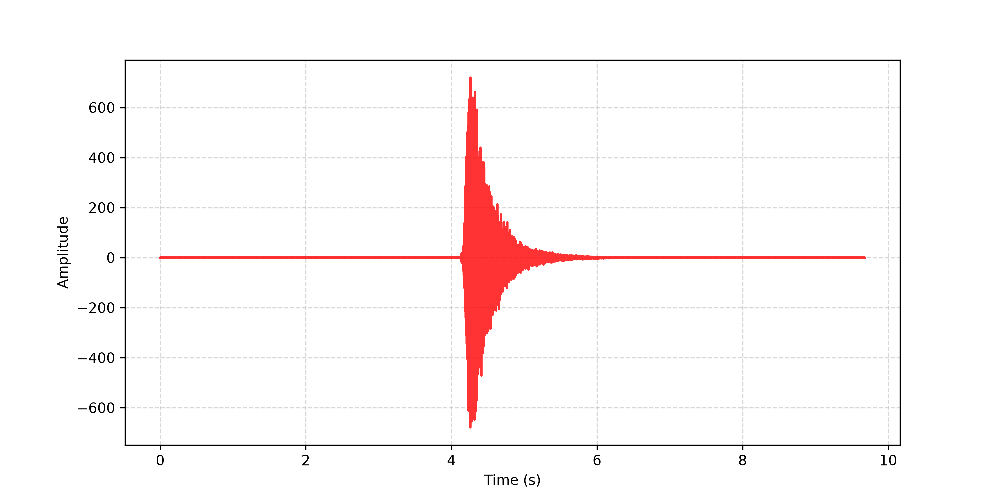
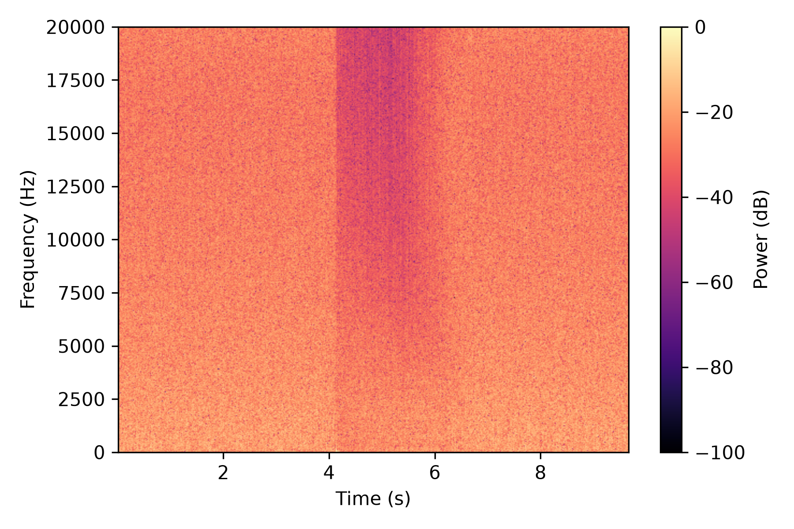

## Overview

This project presents an algorithmic reverberator VST3 plugin optimized for medium- to large-sized halls, built in C++ using the JUCE framework. 

### Key Specifications & Features
* **12×6 Coprime Topology:** Incorporates 12 parallel Low-Pass Comb Filters (LBCFs) and 6 series All-Pass Filters (APFs) with incommensurate delay lengths to maximize modal and echo density while avoiding structural resonance overlap.
* **FOH Low-End Management:** Features a 150 Hz series input High-Pass Filter (HPF) on the wet path to protect PA systems from low-frequency buildup and preserve subwoofer headroom.
* **Control Parameters:** Exposes smooth, real-time controls for **Dry/Wet** mix and **Room Size** scaling.

### Project Goals
Designed as an applied DSP research project to evaluate the electroacoustic trade-offs between modal density, tail diffusion, real-time memory access, and execution performance in digital reverberation engines.
## Empirical Verification & Acoustic Analysis

To validate the acoustic performance of the 12×6 coprime matrix, a 1-sample Dirac impulse was processed through the engine at 100% Wet mix. The resulting impulse response was analyzed using custom SciPy time-frequency visualization tools (`scripts/analyze_ir.py`).

### 1. Impulse Response Decay Envelope

* **Decay Profile:** Demonstrates smooth, monotonic exponential decay with an estimated $\text{RT}_{60}$ of $\approx 1.8\text{ seconds}$.
* **Transient Stability:** The absence of late-tail amplitude spikes confirms high echo density without discrete flutter echoes.

### 2. Time-Frequency Spectrogram & Damping

* **High-Frequency Damping:** High frequencies ($>10\text{ kHz}$) exhibit accelerated energy dissipation, accurately simulating room air absorption.
* **Sub-Bass Attenuation:** Energy below $150\text{ Hz}$ is suppressed by the input High-Pass Filter, preserving FOH subwoofer headroom.
* **Modal Diffusion:** Continuous spectral energy distribution across the mid-band demonstrates high modal density without metallic resonance lines.
